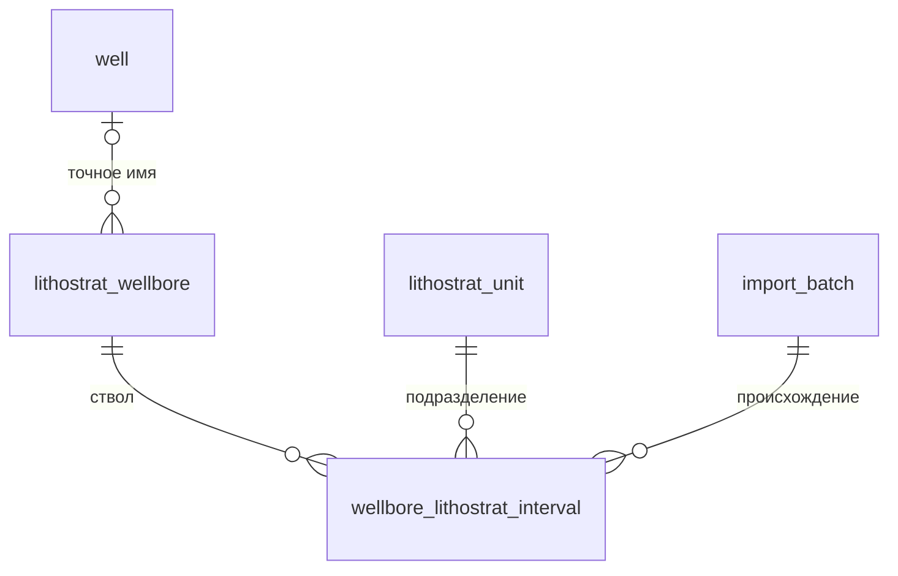

# Литостратиграфия скважин

Источник: `strat_litho_wellbore.xlsx`, лист `strat_litho_wellbore`, строки 2–2515,
столбцы A:E. Книга прочитана без изменений. Исходные пять полей:
`Wellbore name`, `Top depth [m]`, `Bottom depth [m]`, `Lithostrat. unit`, `Level`.

## Таблицы

| Объект | Назначение / количество после импорта |
|---|---|
| `geochem.lithostrat_wellbore` | 181 ствол, исходное имя и необязательная ссылка на `well` |
| `geochem.lithostrat_unit` | 51 наименование подразделения с уровнем |
| `geochem.wellbore_lithostrat_interval` | 2 514 интервалов, кровля, подошва, вычисляемая мощность, происхождение и исходные ячейки |
| `geochem.v_wellbore_lithostratigraphy` | Все интервалы с наименованиями, площадью, месторождением и координатами из связанных скважин |
| `geochem.v_lithostrat_interval_overlap` | Пересечения интервалов одинакового уровня в одном стволе и одной загрузке |



При загрузке создан `import_batch_id = 8` с SHA-256
`3f885d4574182b87e0046e8ba5b5410a34ab6cac91f35d1ef394da1cd56139ff`.
Номер Excel-строки и имя листа вместе с идентификатором загрузки уникальны.
Все исходные поля дополнительно сохранены в `raw_cells`.

Распределение интервалов: `GROUP` — 832, `FORMATION` — 1 643,
`MEMBER` — 33, `SUBGROUP` — 6. Названия, включая `NO FORMAL NAME`, `UNDEFINED GP`,
`BASEMENT` и норвежские символы, не менялись. Ранг взят из столбца `Level`.
Родительские связи между подразделениями не выводились из совпадения глубин.

## Сопоставление и площадь

127 стволов точно сопоставлены с `well.well_name`, 54 не найдены и сохранены
с `well_id = NULL`. Суффиксы `R`, `R2`, `S`, `A`, `T2`, `ST3` не удаляются и
не считаются взаимозаменяемыми. Новые геохимические скважины и пробы не создавались.
Две геохимические скважины отсутствуют в Excel: `7220/11-3 T2`, `7228/7-1 ST3`.

В Excel нет площади, месторождения, страны или координат. Эти сведения
доступны только через существующую связь с `well`. Для несопоставленных стволов
они остаются неизвестными. Фильтр `WHERE area = 'Barents Sea'` исключает эти 54 ствола;
запрос без фильтра сохраняет все исходные интервалы.

## Глубины и исходная неоднозначность

Глубины хранятся как `numeric` без заданной шкалы, мощность вычисляется как
`bottom_depth_m - top_depth_m`. Проверяются конечность, неотрицательная кровля
и положительная мощность. Вложенность GROUP/FORMATION/MEMBER разрешена.
В источнике не указаны datum и MD/TVD, поэтому `depth_reference` остаётся `NULL`.
Автоматическое отнесение геохимических проб к этим интервалам не выполнялось:
сначала необходимо подтвердить совместимость отсчёта глубин.

Сохранён один конфликт одинакового уровня в `7221/4-1`:
`NO FORMAL NAME` и `KOBBE FM`, обе записи `FORMATION` в интервале 1355.7–1417.5 м,
строки Excel 1797 и 1798. Его показывает `v_lithostrat_interval_overlap`.
Ни одна строка не удалена и не исправлена автоматически.

## Запросы

```sql
SELECT area, wellbore_name, unit_level, unit_name,
       top_depth_m, bottom_depth_m, thickness_m
FROM geochem.v_wellbore_lithostratigraphy
ORDER BY wellbore_name, top_depth_m, bottom_depth_m, unit_level;
```

Точная пятиколоночная проекция Excel и другие запросы — в
`lithostratigraphy_examples.sql`.

## Повторный импорт и проверка

```powershell
.\.venv\Scripts\python.exe -m autopyro.database.tools.import_lithostratigraphy 'D:\path\strat_litho_wellbore.xlsx'
docker compose exec -T postgres psql -X -v ON_ERROR_STOP=1 -U admin -d geochemistry -f /checks/validate_lithostratigraphy.sql
```

Зависимости: `requirements-import.txt`. Параметры подключения — как у
`import_parquet.py`, через `PG*` или значения локального Compose.
Миграция `003_wellbore_lithostratigraphy.sql` и вся загрузка выполняются одной
транзакцией; источник проверяется по SHA-256 до и после загрузки.
Повторный запуск для того же файла завершился без изменений.

Каждое из пяти исходных значений, мощность, исходный снимок и соответствие скважине
сверены перед COMMIT. Все 20 интеграционных проверок прошли на PostgreSQL 18.6:
полнота, точность сопоставления, сохранение неизвестной площади, отражение конфликта,
защита от неверных глубин, рангов, внешних ключей, дубликатов и удаления связанных
справочников. Исходные 31 665 геохимических проб и 1 056 734 результатов не изменились.

Тестовые изменения откатились. Тест содержит контрольные количества конкретной
текущей загрузки; при добавлении новых файлов их нужно обновить или ограничить batch.
Машиночитаемый отчёт: `import_reports/strat_litho_wellbore.json`.
