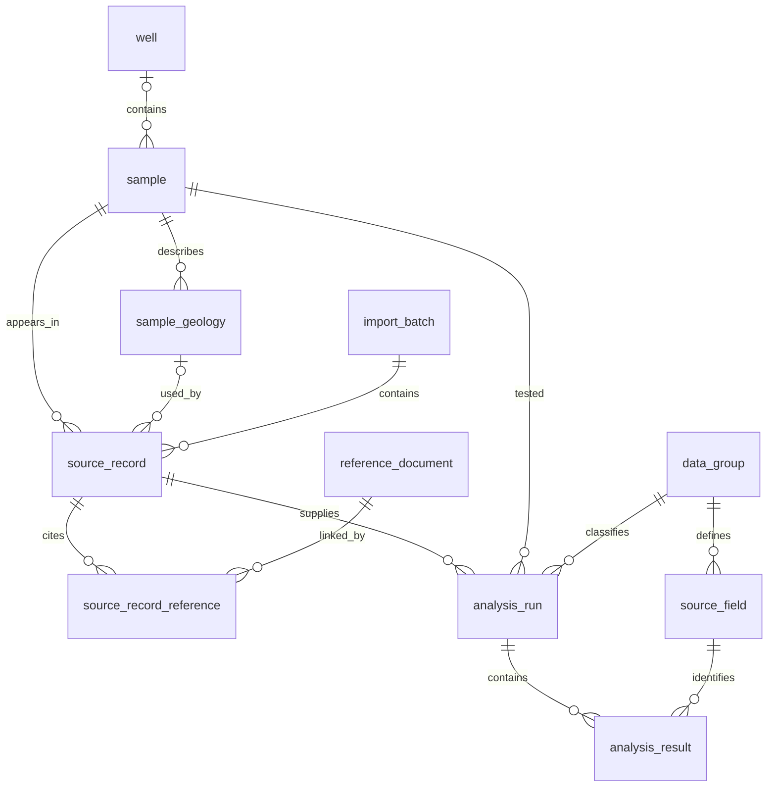

# Схема геохимических данных PostgreSQL

Обновление всей схемы одной командой и журнал миграций: [MIGRATIONS.md](MIGRATIONS.md).
Измерения и оптимизация аналитических запросов: [PERFORMANCE.md](PERFORMANCE.md).
Проверенное резервное копирование и восстановление: [BACKUPS.md](BACKUPS.md).

Справочники показателей, единиц и методов: [ANALYSIS_CATALOGS.md](ANALYSIS_CATALOGS.md).
Экспертная проверка и история сопоставлений: [CATALOG_REVIEW.md](CATALOG_REVIEW.md).
Общий справочник стволов и сведения о глубинах: [WELLBORES.md](WELLBORES.md).
Аналитические выборки по пробам, скважинам и глубинам: [ANALYTICAL_VIEWS.md](ANALYTICAL_VIEWS.md).
Качество измерений, пределы обнаружения и неопределённость: [RESULT_QUALITY.md](RESULT_QUALITY.md).
Версии литостратиграфических интерпретаций: [LITHOSTRAT_VERSIONS.md](LITHOSTRAT_VERSIONS.md).
Привязка проб к выбранной интерпретации: [SAMPLE_LITHOSTRAT_MATCHING.md](SAMPLE_LITHOSTRAT_MATCHING.md).

Доступ: `admin` — полный, `readonly` — SELECT. Пароли находятся в локальном `.env`.
Подробнее: [ACCESS.md](ACCESS.md).

Литостратиграфия из Excel добавлена отдельными таблицами и представлениями:
см. [LITHOSTRATIGRAPHY.md](LITHOSTRATIGRAPHY.md).

Схема подготовлена по предоставленному выводу `dataframe.dtypes`: **4 261 поле, 55 групп**.
Предполагается, что два первых элемента строки — уровни имени столбца `(группа, показатель)`,
а одна строка исходного DataFrame описывает пробу и связанные с ней результаты.
Это допущение нужно проверить по самим данным: `dtypes` не устанавливает гранулярность,
уникальные ключи, полноту, диапазоны и правила объединения записей.

## Файлы и запуск

Python-код находится в пакете [autopyro.database](../autopyro/database/README.md).
Ниже перечислены SQL-ресурсы этой папки и утилиты из `autopyro/database/tools/`.

- `schema.sql` — создание схемы `geochem`, таблиц, связей, индексов, представления и заполнение каталога всех полей.
- `field_catalog.csv` — точное соответствие исходной пары имён, типа, единиц и места хранения.
- `examples.sql` — запросы и пример загрузки с откатом транзакции.
- `generate_schema.py` — воспроизводимая генерация SQL и CSV, стандартная библиотека Python.
- `import_parquet.py` — транзакционный импорт Parquet с проверкой типов и значений.
- `migrations/002_metis_sample_status.sql` — дополнительное поле `Metis / Sam Status`,
  обнаруженное в реальном файле и добавляемое импортёром автоматически.

Применение к существующей базе, в которой ещё нет схемы `geochem`:

```sh
psql -v ON_ERROR_STOP=1 -d geochemistry -f database/schema.sql
```

DDL предназначен для PostgreSQL 14+ и выполняется одной транзакцией. Он не создаёт базу
или пользователей. Повторный запуск намеренно завершается ошибкой, чтобы не скрыть
несовместимость уже существующей схемы. Расширения не требуются.

### PostgreSQL через Docker Compose

Из корня проекта:

```sh
docker compose up -d --wait --wait-timeout 120
docker compose exec -T postgres psql -X -v ON_ERROR_STOP=1 -U admin -d geochemistry -f /checks/validate.sql
docker compose exec -T postgres psql -X -v ON_ERROR_STOP=1 -U admin -d geochemistry -f /checks/examples.sql
```

`compose.yaml` запускает официальный образ `postgres:18`. При первом запуске на пустом
томе автоматически выполняется `schema.sql`. Данные находятся в именованном томе
`autopyro-geochem_postgres_data`. Для PostgreSQL 18 том подключён к `/var/lib/postgresql`,
согласно [документации образа](https://hub.docker.com/_/postgres).
Проверка готовности выполняется через TCP, после завершения инициализации.

Параметры локального подключения:

| Параметр | Значение по умолчанию |
|---|---|
| Host | `127.0.0.1` |
| Port | `15432` |
| Database | `geochemistry` |
| User | `admin` для администрирования, `readonly` для чтения |
| Password | `.env`: `POSTGRES_PASSWORD` / `READONLY_PASSWORD` |

Это локальная конфигурация разработки. При необходимости `POSTGRES_PORT` и
`POSTGRES_PASSWORD` задаются переменными окружения или в корневом `.env`.
Порт опубликован только на `127.0.0.1`. Изменение переменной пароля после создания
тома не меняет пароль уже существующего пользователя в PostgreSQL.

Остановка с сохранением данных:

```sh
docker compose down
```

На существующем томе init-скрипт повторно не выполняется; изменения схемы требуют
миграции. Проверки транзакционны и откатывают тестовые записи, но последовательности
идентификаторов могут продвинуться. Не выполняйте `schema.sql` вручную поверх уже
инициализированной схемы.

### Импорт Parquet

Импортёр использует PyArrow и Psycopg; pandas не требуется. Например, в PowerShell,
после создания виртуального окружения Python 3.12:

```powershell
.\.venv\Scripts\python.exe -m pip install -r database/requirements-import.txt
.\.venv\Scripts\python.exe -m autopyro.database.tools.import_parquet 'Geochemical database Barents Sea.parquet' --inspect
.\.venv\Scripts\python.exe -m autopyro.database.tools.import_parquet 'Geochemical database Barents Sea.parquet'
```

По умолчанию используются параметры локального Compose из таблицы выше.
Переопределение: `PGHOST`, `PGPORT`, `PGDATABASE`, `PGUSER`, `PGPASSWORD`.
`--inspect` проверяет файл без подключения к базе.

Все изменения, включая миграцию `Metis`, выполняются одной транзакцией. Импортёр
берёт блокировку от параллельного запуска, проверяет SHA-256 по `import_batch` и
пропускает уже загруженный файл. Неизвестные столбцы, несовпадение типов,
нечисловые специальные значения и NUL в тексте приводят к отказу, а не к потере ячеек.
Известное дополнительное поле `Metis / Sam Status` добавляется в `sample` как
`metis_sam_status`, а в каталог — как поле области `core`.

Принятые правила для исходного файла:

- Одна исходная строка — отдельная проба и `source_record`, даже если имя пробы
  отсутствует или повторяется. Совпадение имён не считается доказательством тождества.
- Скважины и библиографические записи объединяются только по полному совпадению
  всех соответствующих исходных атрибутов внутри текущего файла. Между разными
  загрузками автоматического объединения сущностей нет.
- Создаются только непустые геологические описания и аналитические группы.
- Исходный `RangeIndex` данного файла совпадает с `row_number`; остальные данные
  хранятся как ненулевые тройки `[group, label, value]` в `source_record.raw_cells`.
  Пропущенные ячейки восстанавливаются по каталогу столбцов.
- Все значения каждого результата, каждого основного атрибута и исходного снимка
  сверяются до фиксации транзакции. Даты остаются исходным текстом.
- После фиксации выполняется `ANALYZE`. Отчёт сохраняется в `import_reports/`.

Базовый `field_catalog.csv` содержит исходные 4 261 поле; после миграции в базе
4 262 поля и 56 групп. `validate.sql` поддерживает обе версии и не удаляет реальные данные.

## Структура



| Таблица | Назначение |
|---|---|
| `well` | Все 38 полей `Well`: имя, координаты, глубины, оператор и прочие атрибуты |
| `sample` | Все 23 поля `Sample` и необязательная ссылка на скважину |
| `sample_geology` | Все 18 полей `Geol`; допускает несколько описаний одной пробы |
| `reference_document` | Все 4 поля `Ref`; связь с исходной записью через отдельную таблицу |
| `import_batch` | Имя источника, необязательная SHA-256, время загрузки |
| `source_record` | Номер исходной строки внутри загрузки, проба, геологическое описание, необязательные исходные ячейки |
| `data_group` | 55 исходных групп, из которых 51 — группы анализов |
| `source_field` | Каталог всех 4 261 полей с исходными названиями, типами, единицами и назначением |
| `analysis_run` | Один анализ определённой группы, ссылка на пробу и исходную строку, номер повтора |
| `analysis_result` | Одно непустое значение показателя внутри анализа |
| `v_analysis_result` | Представление результатов с названиями показателей и единицами |

Основные сущности имеют обычные типизированные столбцы. Для большого и расширяемого
набора аналитических показателей используется типизированная EAV-модель:
`analysis_run → analysis_result → source_field`. Она увеличивает число строк и требует
агрегации для широких отчётов, зато позволяет добавлять показатели без изменения DDL.
Для часто используемых отчётов можно позднее добавить специализированные представления.

Одна таблица на весь DataFrame не подходит: PostgreSQL допускает максимум 1 600 столбцов
в таблице, а практический предел может быть ниже из-за размера строки.
Источник: [PostgreSQL Limits](https://www.postgresql.org/docs/current/limits.html).

## Типы и сохранение смысла

| pandas dtype | PostgreSQL | Хранение результата анализа |
|---|---|---|
| `string` | `text` | `value_text` |
| `Int64` | `bigint` | `value_int` |
| `Float64` | `double precision` | `value_float` |

Для nullable-типов pandas пропуски становятся SQL `NULL` в основных таблицах.
В `analysis_result` строки для пропущенных ячеек не создаются: существующая строка
обязана содержать ровно одно значение правильного типа. Это экономит место при
разреженных данных. Отсутствие строки означает отсутствие переданного значения,
а не ноль или результат «ниже предела обнаружения».

`bigint` сохраняет диапазон `Int64`; `double precision` соответствует 64-битным
вещественным данным. Целые значения не пропускаются через `float`: большие целые
при таком преобразовании могут потерять точность. Описание типов:
[PostgreSQL Numeric Types](https://www.postgresql.org/docs/current/datatype-numeric.html).

Особенности исходного файла:

- `Date`, `Start date`, `Compl date`, `Sam date` имеют тип `string`, поэтому остаются
  текстом. `analysis_run.analyzed_on` — дополнительная дата, которую можно заполнить
  после проверки формата; исходное текстовое значение сохраняется отдельно.
- `Alt Names`, `Quad`, `Block`, `SRS code` остаются `bigint` по предоставленному типу.
  Для кодов и имён стоит проверить необходимость `text`: ведущие нули, уже потерянные
  в DataFrame, по `dtypes` восстановить нельзя.
- Единицы извлекаются только из последнего блока ` [...]`, отделённого пробелом.
  Например, `nC10[h] [count]` сохраняется целиком в `source_label`, единица — `count`.
  Обозначения `[h]`, `[a]`, `[ch]`, `[ca]`, `[vol]`, `[mol]`, `[un]` не объединяются.
- Единицы хранятся буквально. `unknown`, `Euc` и сложные обозначения не получают
  придуманной интерпретации или автоматического пересчёта.
- `Pyrol6`, `Pyrol6-Extr`, другие методы и фракции — разные группы.
  `TOC` из `Leco` и `Pyrol6` — разные показатели.
- Поля `Lab`, `Method`, `Eqp`, `Quality`, комментарии и исходные даты анализа входят
  в `analysis_result` как текстовые показатели своей группы. Они не теряются.
- Составные внешние ключи запрещают результат из другой группы, другой тип значения
  и анализ, привязанный к пробе, отличающейся от пробы исходной строки.
- `NaN` и бесконечности запрещены в `analysis_result`. Пропуски pandas пропускаются,
  бесконечности и нераспознанные значения фиксируются при импорте как ошибки качества.
  Основные таблицы требуют аналогичной проверки на этапе импорта.

## Правила загрузки

1. Создать `import_batch`. Задать стабильный порядковый `row_number`, начиная с 0.
   Индекс pandas может содержать дубликаты и не должен автоматически становиться ключом.
2. Создать или сопоставить `well`, затем `sample`. Для нескважинной пробы `well_id = NULL`.
   Имена скважин, имена проб и `Internal#` индексируются/сохраняются без предположения
   об уникальности. Для первой загрузки безопаснее создавать отдельные сущности,
   пока правила сопоставления не определены; возможные дубликаты затем согласовать.
3. Заполнить `sample_geology` и `reference_document`, если соответствующие группы непусты.
   Создать `source_record`, указать выбранное геологическое описание и связи с документами.
4. Для каждой непустой аналитической группы строки создать `analysis_run`.
   Сведения о повторе из `Sample / Repeat` сохраняются текстом в пробе; их значение
   нельзя автоматически считать числовым `repeat_number`.
5. Найти каждое поле по `(group_name, source_label)` в `source_field`.
   Записать значение в столбец, соответствующий `source_dtype`. Копировать тип из каталога,
   не определять его заново по отдельной ячейке. Основные поля писать по CSV-сопоставлению.
6. Выполнять загрузку транзакционно. Уникальность `(import_batch_id, row_number)` защищает
   от повторения строки внутри одной загрузки; новый batch с тем же файлом автоматически
   не блокируется. SHA-256 служит для поиска повторных файлов, а не уникальным ключом.

При необходимости точного аудита сохранить `raw_cells` как массив троек
`[["Well", "Well Name", "W-1"], ["Pyrol6", "TOC [%wt]", 2.35]]`.
JSON должен содержать допустимые JSON-значения: пропуски — `null`; нечисловые специальные
значения — явные текстовые маркеры с согласованным правилом восстановления.
Изменение основных сущностей впоследствии не должно уничтожать исходный снимок.

Схема не вводит диапазоны концентраций, процентов, глубин и координат по одним названиям:
из `dtypes` нельзя доказать соответствующие ограничения или систему координат.
`Lat/Long`, `X/Y` и `SRS code` сохранены отдельно; PostGIS можно добавить после проверки CRS.
Отрицательные изотопные значения допустимы. `numeric(p,s)`, пределы обнаружения,
квалификаторы `<`, погрешности, формулы расчётов и справочники лабораторий требуют
дополнительных сведений. Текущий каталог их не выдумывает.

## Проверка

Генератор проверяет формат строк, поддерживаемые типы и уникальность исходных пар имён.
Каталог сопоставлен с исходным файлом: все 4 261 поле представлены ровно один раз.
Схема развёрнута в PostgreSQL 18.6 через Docker Compose. `validate.sql` успешно
выполнил 32 интеграционные проверки, включая запись и чтение всех исходных полей,
отрицательные проверки ограничений и повторные анализы. Примеры SQL и сохранность
каталога после перезапуска тоже проверены. Подробности — в `VALIDATION.md`.
Версии PostgreSQL 14–17 и производительность на реальном объёме данных не проверялись.
