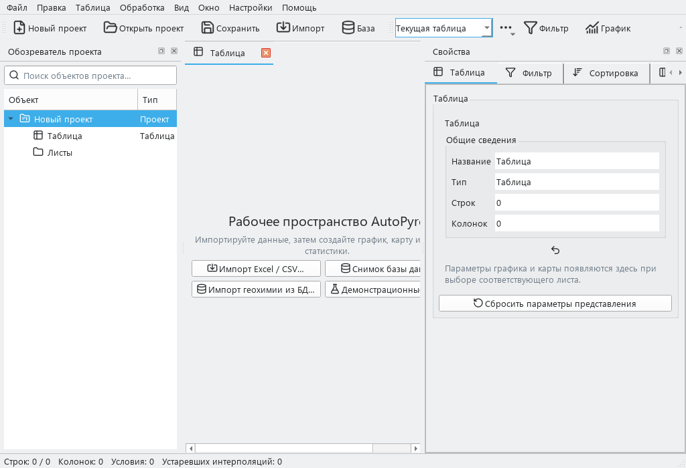

# Аудит готовности AutoPyro к выпуску

22 ноября 2026 года. Проверялось рабочее дерево Windows с незакоммиченными изменениями поверх `3f7e7eb`. Целевая аудитория для оценки — геохимик, который получает лабораторную таблицу, проверяет измерения, интерпретирует их и передаёт коллеге результат.

**Решение о выпуске.** Функциональность уже позволяет провести пробу от импорта до отчёта с историей измерений. Общий выпуск стоит отложить. В проверенных сценариях приложение может перезаписать соседний проект, восстановить другой проект или преждевременно удалить автокопию. После устранения этих рисков имеет смысл выпустить пилот для ограниченного круга лабораторий. Расширять каталог методов для этого не требуется.

## Риски с воспроизведением

P0 означает риск для файла или идентичности проекта, который блокирует пилот с рабочими данными. P1 означает дефект, который существенно мешает работе или снижает доверие к результату. Все эксперименты с файлами ниже выполнены на специально созданных временных проектах.

| Приоритет | Действие | Фактический результат | Критерий исправления |
|---|---|---|---|
| P0 | Создать два разных проекта. В «Сохранить как» ввести `other.csv` в каталоге, где уже лежит `other.apyro`. Файл `other.csv` отсутствует. | Qt-диалог в offscreen и системный диалог Windows вернули `other.csv`. В нативной проверке имя было заранее заполнено и подтверждено кнопкой сохранения. После закрытия диалога приложение заменяет суффикс и записывает `other.apyro`. UUID существовавшего проекта сменился. Подтверждения для итогового пути не было. | Показать точное имя назначения до записи. При отмене или отказе содержимое существующего проекта побайтно сохраняется. Проверить также ввод без суффикса и с несколькими точками. [Сохранение](../autopyro/ui/project_session.py#L175) |
| P0 | Положить рядом проекты `well[12].apyro` и `well1.apyro` с разными UUID и более новыми автокопиями. Открыть первый и согласиться на восстановление. | В окне открылся проект с UUID второго файла, а путь текущего проекта стал `well1.apyro`. Имя первого файла передаётся в шаблон поиска, где квадратные скобки имеют специальное значение. Даже единственная собственная копия первого проекта этим шаблоном пропускается. | Для любого допустимого имени выбирать копии по буквальному имени и проверять их принадлежность проекту. После восстановления совпадают ожидаемые UUID и целевой путь. [Поиск и привязка](../autopyro/ui/autosave.py#L23) |
| P1 | В изменённом проекте дождаться автокопии. Нажать «Открыть», выбрать «Не сохранять», затем отменить выбор нового файла. | Старый проект остался открытым с пятью строками и признаком несохранённых изменений. Файл автокопии уже исчез. До следующей успешной автокопии аварийное завершение лишает пользователя этого способа восстановления. Такая же последовательность возможна при отмене импорта нового проекта. | Удалять копию при состоявшейся замене или закрытии. При отмене, ошибке чтения и отказе на последнем шаге сохранять действующий проект и его копию. [Решение об отказе](../autopyro/ui/project_session.py#L100) · [Импорт](../autopyro/ui/data_io/table_import.py#L11) |
| P1 | Открыть повреждённый основной файл, рядом с которым лежит исправная более новая автокопия. | По отдельности копия обнаруживается. Команда открытия показывает ошибку чтения основного файла до предложения восстановиться. Ручная команда восстановления остаётся доступна пользователю, который знает, где искать копию. | Из сообщения об ошибке можно перейти к проверенной копии. Отказ сохраняет текущий сеанс, а восстановление оставляет оригинал доступным для разбора. [Открытие](../autopyro/ui/project_session.py#L150) |
| P1 | Подогнать Y по X для 20 проб, применить результат и изменить только текстовое примечание одной из этих проб. | Контрольная сумма X и Y осталась прежней. Все шесть колонок прогноза, остатка и границ получили признак устаревания. Строка состояния показала «Устаревших интерполяций: 6», хотя в проекте нет интерполяций. | Правка примечания сохраняет актуальность. Изменение входа, единицы или используемого веса корректно меняет статус. Интерфейс называет вид результата и показывает, что требует пересчёта. [Инвалидация кривых](../autopyro/curves/curve_outputs.py#L81) · [Строка состояния](../autopyro/ui/window_status.py#L13) |
| P1 | Трижды открыть отчёт из главного окна, собрать его и закрыть. Обработать отложенное удаление Qt и вызвать сборку мусора Python. | После каждого закрытия в главном окне оставалось соответственно одно, два и три скрытых окна отчёта. У каждого сохранялся собственный `report_source`. Установлено удержание объектов. Объём потерь памяти на часовой лабораторной сессии требует замера. | После закрытия освобождаются окно и снимок либо остаётся один намеренно переиспользуемый экземпляр. Серия из 20 открытий выходит на плато по числу живых снимков и памяти. [Открытие отчёта](../autopyro/ui/analysis_documents.py#L119) · [Владение снимком](../autopyro/ui/dialogs/report_preview.py#L125) |
| P1 для поставки с администрированием PostgreSQL | Собрать wheel с доступными исходной SQL-схемой и миграциями. Распаковать его отдельно от checkout и вызвать штатный загрузчик миграций. | Wheel собрался. Из него запустилось главное окно с демопроектом 5 × 6 на существующих зависимостях. При 15 входных SQL-файлах схемы и миграций в wheel попало 0. Загрузчик завершился с `ValueError: No migrations found` до подключения к серверу. | Если инструменты БД входят в поставку, они находят схему и тот же набор миграций вне репозитория. Если они поставляются отдельно, у администратора есть отдельный комплект и проверенная инструкция. [Загрузчик](../autopyro/database/tools/migrate.py#L14) · [Состав пакета](../pyproject.toml#L22) |

## Функциональность и качество реализации

**Сквозная проверка на примере из поставляемого репозитория.** Через мастер импорта открыты шесть проб из `examples/pyrolysis.csv`. Фильтр скважины Demo-A оставил четыре. В листе интерполяции использованы MD, S2, группировка и максимальный разрыв 30. Для пропуска на 1010 м получено S2 ≈ 4,2 мг УВ/г породы. После создания отдельной колонки, сохранения и открытия проекта исходная ячейка осталась пустой, значение в вычисленной колонке сохранилось, повтор по протоколу дал тот же результат. По четырём пробам собран отчёт и записаны все четыре формата. Сценарий подтверждает совместную работу импорта, выборки, расчёта, хранения и отчётности. [Данные примера](../examples/pyrolysis.csv)

| Область | Что можно сделать | Оценка для лабораторной работы |
|---|---|---|
| Проект и измерения | Хранить данные в SQLite v4. Различать пробу, анализ, измерение и рабочий результат, сохранять UUID, исходное представление, единицы, пределы обнаружения, неопределённость и редакции. Открывать прежние форматы, восстанавливать снимки, обнаруживать конфликт записи. | Сильная основа прослеживаемости. На уровне хранения есть атомарная замена и резервирование старых форматов. На уровне пользовательского выбора файла остаются три описанных выше сценария перезаписи, неверной привязки и удаления копии. [Хранение](../autopyro/database/storage.py#L242) · [Приёмка миграций и измерений](../tests/test_measurement_storage.py) |
| Импорт и источники | Читать CSV/TSV/XLSX, выбирать лист и диапазон, сопоставлять заголовки и единицы, сохранять шаблоны, добавлять измерения и разбирать совпадения. Читать снимки SQLite/PostgreSQL и обновлять их с учётом локальных решений. | Сохранение исходной строки и явный выбор при конфликте особенно ценны для повторных анализов. Уже можно загрузить два анализа одной новой пробы за один импорт. Слабое место при расширении проекта — работа с несколькими независимо обновляемыми источниками. [Приёмка повторов](../tests/test_import_acceptance.py#L225) · [Обновление снимка](../tests/test_database_refresh_acceptance.py) |
| Таблица и выборки | Редактировать измерения, отменять и повторять правки, закреплять колонки, сортировать, комбинировать фильтры, сохранять представления и наборы проб, экспортировать текущие или выделенные данные. | Понятное разделение идентичности пробы и её места в таблице. Общий выбор области анализа помогает сверять график и таблицу. Пользователю всё ещё приходится различать текущую таблицу, выделение, постоянный набор и локальные ограничения отдельного анализа. [Область анализа](../autopyro/ui/analysis_scope.py#L81) · [Проверка закрепления](../tests/test_table_acceptance.py#L1014) |
| Контроль качества | Искать проблемные измерения, видеть исходное значение и причину, принимать решения с комментариями, исключать из отдельных видов анализа, переходить к пробе и отменять решение. | QC связан с рабочим измерением и последующими вычислениями. Сквозная проверка связывает выбор повтора, изменение HI, исключение, график, отчёт и открытие проекта. Для выпуска стоит утвердить лабораторные пороги и правила для тех непиролитических профилей, которые войдут в пилот. [Сквозной сценарий](../tests/test_pyro_acceptance.py#L19) · [Правила QC](../SCIENTIFIC_METHODS.md#L3) |
| Расчёты пиролиза и интерпретация | Рассчитывать HI, OI, PI и GP, проверять единицы, видеть диагностику недоступных результатов, классифицировать по схемам, изучать границы и неопределённость, хранить редакции и решения эксперта. | Трассировка от результата к входным данным хорошо подходит для проверки специалистом. Встроенные эталоны обнаруживают сдвиг границ. Для выпуска нужен перечень принятых редакций с областью применимости и решением независимого геохимика. [Граничные случаи](../tests/test_interpretation_reference_cases.py) · [Порядок экспертной приёмки](INTERPRETATION_EXPERT_REVIEW.md) |
| Пирограммы | Читать S00 и табличные сигналы, сравнивать каналы и стадии, переключать оси, проверять исходник по хешу и сохранять историю. | Просмотрщик позволяет вернуться к приборному сигналу. На первом релизе следует явно перечислить принятые приборные варианты, единицы и стадии. Интегрирование пиков имеет смысл планировать отдельной функцией. [Приёмка двух стадий](../tests/test_pyrogram_table.py#L13) |
| Интерполяция по глубине и статистика | Строить линейную, ближайшую, PCHIP- и сплайн-интерполяцию. Учитывать ствол, контекст и разрыв между опорами. Рассчитывать групповые статистики, корреляции и матрицы. | При отказе от интерполяции можно установить причину и проверить опоры. Интервальные пробы требуют отдельной политики. В статистике важна видимость фактического числа пригодных пар после исключений и смены рабочего измерения. [Проверки ограничений](../tests/test_interpolation_constraints.py) · [Статистика](../autopyro/analysis/statistics.py) |
| Подгонка кривых | Сопоставлять модели, использовать веса, ошибки обеих осей, устойчивую подгонку и bootstrap, оценивать остатки, сравнивать серии и сохранять результаты. | Есть независимые численные сравнения и контроль воспроизводимости полос. Основной воспроизведённый дефект относится к актуальности сохранённого результата после редактирования. [Численные проверки](../tests/test_curve_fitting_audit.py) · [Работа из интерфейса](../tests/test_curve_workflow_gui.py) |
| Графики | Строить диаграммы и глубинные планшеты, настраивать фильтры, неопределённость, категории, аннотации и оформление, связывать точки с пробами и экспортировать изображения. | Связь точки с UUID и сохранённое оформление позволяют вернуться к исходному наблюдению. Для больших проектов важны время до первого пригодного кадра и паузы при автокопии. Повторная отрисовка и первый запуск дают разные ощущения. [Подготовка и экспорт](VISUALIZATION_AUDIT.md) |
| Стратиграфия, карты и региональный анализ | Работать с интервалами и редакциями, сопоставлять колонки скважин, загружать векторные слои, задавать систему координат, агрегировать пробы, строить поверхности IDW, TIN, RBF и кригинг. Добавлять сохранённый вид карты в отчёт. | Есть сквозной тест с таблицей NPD, слоями, сохранением, экспортом и повторным открытием. Для пространственного прогноза важны отдельная проверка вне обучающих скважин и явная область допустимого прогноза. Расчёт траектории MD → TVD/TVDSS — последующее расширение. [Карта из реальных файлов](../tests/test_map_workflow_acceptance.py#L26) · [Карта в отчёте](../autopyro/ui/dialogs/report_forms.py#L214) |
| Непиролитическая геохимия и модели | Собирать паспорта и сравнения проб, работать с изотопами, газом, витринитом, SARA, элементным составом и биомаркерами, сравнивать смеси, применять PCA, кластеризацию и прогноз. | Для ряда методов есть примеры на опубликованных данных, включая несовпадение наблюдений с моделью. Для обещаний пользователю важны конкретные материал, метод, фракция и единицы. Обобщать качество прогноза на незнакомую лабораторию следует после внешней проверки. [Приёмка геохимического процесса](../tests/test_geochemistry_workflow_acceptance.py) |
| Отчётность и обмен | Выпускать HTML, PDF, DOCX и JSON, собирать пакеты, применять шаблоны, добавлять карту, проверять готовность, сравнивать снимки по хешам. | Отчёт опирается на зафиксированный набор данных. Для короткого DOCX в предыдущей приёмке подтверждена одна страница в Word 2019. До выпуска важны освобождение снимков, проверка длинных смешанных отчётов и перенос исходных файлов на другой компьютер. [Генератор](../autopyro/reports/reporting.py) · [Нативная проверка Word](UI_UX_FUNCTIONAL_AUDIT_2026-11-17.md#L78) |

## Читаемость и сопровождение кода

**Структура репозитория помогает найти место изменения.** В пакете приложения 372 Python-файла и 83 623 физические строки, включая комментарии и пустые строки. В каталоге тестов 147 модулей `test_*.py`. Код разделён по предметным областям. Архитектурные тесты следят за границей между ядром и Qt. Общий реестр документов связывает пункты меню с листами и обозревателем. Для знакомого с предметной областью разработчика это хорошие точки входа. [Границы модулей](../tests/test_ui_architecture.py#L211) · [Реестр листов](../autopyro/ui/document_descriptors.py)

**Самые дорогие изменения сосредоточены в нескольких функциях.** По синтаксическому дереву `render_plot` занимает 584 строки, `_section_blocks` — 554, `run_checks` — 439, `render_map` — 360, `build_report` — 336. Разработчику одного нового типа диаграммы, раздела отчёта или правила QC приходится читать соседние сценарии. Начать стоит с добавляемого правила или раздела: выделить его подготовку и результат, сохранить текущие публичные вызовы, сравнить выход на существующих эталонах. Массовое переименование файлов даст мало пользы. [Отрисовка графиков](../autopyro/visualization/plotting.py#L740) · [Блоки отчёта](../autopyro/reports/reporting.py#L848) · [Правила QC](../autopyro/analysis/qc.py#L324)

**Владение состоянием сложнее структуры каталогов.** В предметной модели есть типы `Project`, `Column` и `Row`. При этом настройки и результаты многих научных модулей живут в общих словарях `project.view` и `column.metadata`. Центральный `Project.refresh` знает о нескольких движках, а различие между изменённой строкой и изменённым входом критично для вывода. Это проявилось в ложном устаревании кривой. Начать можно с явного контракта «входы этого расчёта и причина его устаревания» для одной подгонки, включая совместимость с уже сохранёнными проектами. [Модель и пересчёт](../autopyro/model/core.py#L71)

**В интерфейсе полезно закрепить владельца окна и момента сохранения.** `ProjectSession` выделен отдельно, однако проверка возможности уйти с проекта уже изменяет файлы. Главное окно сохраняет многочисленные делегирующие свойства, а окна отчёта переживают закрытие. Новому разработчику трудно увидеть такие последствия из названия метода. Для каждого из этих двух случаев достаточно одного явно названного места, где операция считается завершённой, и регрессионного теста на штатный пользовательский путь. [Сеанс](../autopyro/ui/project_session.py#L83) · [Главное окно](../autopyro/ui/window.py#L49)

**Совместимость поддержана осознанно и имеет цену.** Старые пути Python-модулей восстанавливаются через собственный обработчик импорта. Есть тесты на идентичность объектов и оба порядка импорта. Для сопровождения стоит направлять примеры на канонические пути и определить, для каких внешних пользователей сохраняется старый API. Это позволит менять внутреннее устройство без случайного нарушения публичного интерфейса. [Совместимость](../autopyro/_compat.py#L107) · [Проверка порядка импорта](../tests/test_ui_architecture.py#L63)

**Инструкция пользователю отстала от кода.** В «Ограничениях текущей версии» README по-прежнему предлагает два импорта для повторов одной новой пробы, описывает закрепление как перестановку и относит открытие проекта и сборку отчёта к синхронным операциям. Тесты подтверждают повторы за один импорт и неподвижную колонку. Открытие и сборка используют фоновые задачи, хотя пользователь может ждать завершения операции в модальном окне. Эти ошибки ведут к лишней ручной работе и искажают очередь разработки. [README](../README.md#L1515) · [Импорт повторов](../tests/test_import_acceptance.py#L225) · [Закрепление](../tests/test_table_acceptance.py#L1014) · [Сборка отчёта](../autopyro/ui/dialogs/report_preview.py)

## Пользовательский интерфейс

**Печатный отчёт глазами получателя.** В сквозном примере с четырьмя пробами и десятью выбранными колонками PDF с исходными настройками занял 15 страниц. Единицы были заданы для MD и S2. На первой странице есть сводка и понятное объяснение, почему некоторые показатели пропущены. На последней привязка к пробе сохранилась, значение 4,2 видно в отдельной колонке. На страницах 13–14 напечатаны 45 пар корреляций, включая скважину и формацию. У 42 пар в русскоязычном отчёте стоит внутренний код `insufficient_pairs`, у трёх есть коэффициенты. Так специалисту трудно найти три пригодных результата. В кратком шаблоне стоит выводить пары с коэффициентами, сводное число остальных и объяснение на языке отчёта. Полный список оставить доступным в подробном приложении и JSON. [Настройки расчёта отчёта](../autopyro/reports/reporting.py#L357) · [Статус корреляции](../autopyro/analysis/statistics.py#L306)

Для регулярной работы геохимика удачны дерево проекта, вкладки, единая область анализа, обозначение единиц в заголовках и переход к пробе из результата. В листе QC можно увидеть исходное значение, методическое основание, решение и источник. Подсказки, управление с клавиатуры и объявления для средств доступности уже реализованы в ряде форм. Это стоит сохранить при сокращении числа одновременно видимых элементов. [Навигация по QC](../autopyro/ui/dialogs/qc_navigation.py) · [Проверки клавиатуры и доступности](../tests/test_gui.py#L602)

**Выбор способа импорта.** При открытом проекте основная кнопка «Импорт» запускает создание другого проекта. Добавление измерений к текущим пробам находится в соседней команде меню. Для лаборатории, которая последовательно получает несколько файлов, это важное различие лучше назвать непосредственно в интерфейсе: «Открыть таблицу как новый проект» и «Добавить измерения в текущий проект». Диалог выбора файла можно показать до вопроса о сохранении, а окончательное решение принять после успешного чтения. [Команды файла](../autopyro/ui/window_actions.py#L44) · [Обработчик импорта](../autopyro/ui/data_io/table_import.py#L11)

**Первый экран при ширине 1024 px.** На свежих настройках при клиентском размере 1024 × 700 центральная область получила 352 px. На снимке экрана обрезаны заголовок и подписи двух правых кнопок, включая демоданные. Горизонтальная прокрутка доступна далеко внизу. Справа в это время показаны свойства таблицы из нуля строк. Для пустого проекта полезнее отдать место открытию файла, импорту и демопримеру. При узкой центральной области кнопки можно поставить в одну колонку. Критерий — все основные действия читаются полностью до первой прокрутки. [Стартовый экран](../autopyro/ui/workspace.py#L181)

**Выделенный текст трудно читать в обеих темах.** В работающем дереве проекта проверены цвета активного выделения из палитры Qt. В светлой теме белый текст на фоне `#3daee9` даёт контраст 2,49:1, в тёмной текст `#fcfcfc` на том же фоне — 2,43:1. В качестве критерия для обычного текста выбран ориентир W3C 4,5:1. Достаточно скорректировать пару цветов выделения и проверить её в дереве, таблице и списке QC с клавиатурным фокусом. [Привязка цветов в Qt](../autopyro/ui/theme/__init__.py#L41) · [Критерий контраста W3C](https://www.w3.org/WAI/WCAG22/Understanding/contrast-minimum.html) · [Применение к настольному ПО](https://www.w3.org/TR/wcag2ict-22/)

**Размер зависит от истории открытых листов.** В Qt offscreen с Segoe UI и двумя панелями свежий QC принял 1024 × 700. При последовательном открытии расчётов, статистики и QC в одном окне переход в QC дал 1075 × 700, а позднее подгонка — 1161 × 700. На длинном маршруте интерпретация достигла 1161 × 712. Отдельный запуск видимого нативного окна Windows подтвердил эффект при штатном Segoe UI 9 pt и масштабе 100%. После запроса 1024 × 700 фактическая ширина QC составила 1044 px, графика и карты — 1074 px, подгонки — 1126 px. Интерпретация приняла 1126 × 706. На стартовом экране центральная область снова заняла 352 px. Приёмка — пройти всю последовательность и вернуться к таблице с доступными основными действиями, включая переход между мониторами с разным масштабом. [Компоновка](../autopyro/ui/workspace.py#L400) · [Предыдущие нативные замеры отдельных разделов](UI_UX_FUNCTIONAL_AUDIT_2026-11-17.md#L60)

**Понятность статусов.** В QC есть полезные счётчики охвата, однако панель одновременно показывает исключения, параметры, поиск и профиль порогов. В строке состояния уже воспроизведена терминологическая ошибка с подгонкой. Первым делом следует показать выбранную область, число доступных проб, причину исключения или устаревания и следующее допустимое действие. Часто меняемые настройки оставить под рукой, редко используемые раскрывать по запросу. Для новичка полезен короткий встроенный маршрут по реальной пробе от повтора измерения до отчёта. Сейчас в меню «Помощь» зарегистрирована контекстная команда «Что это?». [Меню помощи](../autopyro/ui/window_actions.py#L127)

## Производительность и поставка

В свежем процессе этого аудита на синтетическом проекте 1000 × 8 после шести последовательных сборок и закрытий отчёта остались шесть снимков. После обработки событий Qt и сборки мусора выделенная процессу память Windows (private bytes) составляла по циклам **778, 796, 822, 842, 865 и 887 МиБ**. Между первым и шестым закрытием прирост составил 109 МиБ. Часть памяти может удерживать аллокатор. Количество живых диалогов со снимками проверялось отдельно, поэтому проблему можно воспроизводить и без счётчика памяти.

В сохранённых нативных замерах версии с компактными снимками на 30 000 × 12 при графике и автокопии максимальная пауза интерфейса составила 336–345 мс, пиковая выделенная память группы процессов — 2,34–2,35 ГиБ. Автокопия публиковалась примерно за 22 с. В одном полном цикле с 800 001 измерением первое сохранение заняло 37,97 с, автокопия — 35,03 с, сохранение после восстановления — 41,76 с. Отпечаток проекта и 100 003 записи истории совпали. Это результаты стенда проекта. Для 412 записей в манифесте того замера в ходе аудита проверено совпадение хешей с рабочим деревом. Настоящая проблема для пользователя — сочетание длительного ожидания, отдельных заметных пауз и удержания снимков между операциями. [Замеры и условия](../IMPLEMENTATION_PLAN.md#L97)

В Windows-инструкции запуск требует Python и установки из checkout. В `pyproject.toml` указан `python-docx`, а в перечне фиксированных прямых зависимостей его нет. NumPy напрямую используется в предметном коде и зафиксирован в `requirements.txt`, но отсутствует среди прямых зависимостей пакета. Он может устанавливаться транзитивно. Успешная сборка wheel и запуск из распакованного wheel с уже доступными библиотеками подтверждают работу части поставки. Установку, обновление и удаление на чистом компьютере нужно принять на выбранном релизном артефакте. [Запуск](../README.md#L24) · [Метаданные](../pyproject.toml) · [Фиксация версий](../requirements.txt)

## Основания и границы проверки

**Полный прогон проверенного рабочего дерева.** Windows, Python 3.12.14, PySide6 6.12.0, pytest 9.1.1, `QT_QPA_PLATFORM=offscreen`. За **34 мин 38 с** из 3172 проверок **3158 прошли, 14 пропущены, ошибок и падений нет**. Из пропусков 9 относятся к опциональным графическим библиотекам, 3 — к системному буферу обмена, 2 — к нативному запуску Windows. Девять графических случаев прошли в дополнительных запусках этого аудита. Нативные проверки компоновки и сохранения, описанные выше, выполнены самостоятельными сценариями. Два предупреждения основного прогона касаются оформления незаполненного маркера и намеренной записи тестового слоя без CRS. [JUnit текущего прогона](../tmp/release-audit-layout-1686b9f55c4a425c8366f17bda6b2a3a/regression.xml)

Синтаксически разобраны все Python-файлы приложения. По пользовательским входам проверены жизненный цикл проекта, временные файлы восстановления, подгонка и редактирование таблицы, многократная сборка отчётов, компоновка демопроекта и загрузка ресурсов из wheel. В файловых экспериментах диалоги выбора и ответа автоматизированы. Подмена суффикса отдельно воспроизведена с вводом имени в Qt-диалоге offscreen и подтверждением временного имени в системном диалоге Windows. Компоновка проверена также в видимом нативном окне Windows. Страницы 1, 13 и 15 контрольного PDF просмотрены после растеризации. Установка на чистой ОС, экранный диктор и независимая научная экспертиза остаются отдельными проверками.

Штатное подключение с ролью только для чтения к настроенному локальному PostgreSQL дважды завершилось тайм-аутом. Доступность схемы и обновление снимка на этом экземпляре подтвердить не удалось. Для опциональной визуализации использованы установленные отдельно Seaborn и UltraPlot. В рабочем дереве прошли семь проверок построения и пять параметризованных проверок переключения движков из интерфейса, включая оба опциональных движка.

Заново выгружены и воспроизведены встроенные эталоны интерпретации. Для **39 схем и 323 случаев** получено ноль расхождений с ожидаемыми результатами и ноль неуспешных проверок единиц. Все 39 контрольных сумм совпали с редакциями в существующем локальном листе экспертных решений. У всех 39 в этом листе указан статус «Ожидает». Это позволяет ставить точную задачу эксперту и привязывать последующее решение к уже проверенной редакции. [Экспорт и повторная проверка](../tools/export_interpretation_expert_review.py) · [Порядок экспертной работы](INTERPRETATION_EXPERT_REVIEW.md)

Сверены JUnit-отчёты полного прогона от 22 ноября на замороженной копии: 3153 успешных, 14 пропущенных, 0 падений. Все 14 прошли отдельно на том же снимке — 5 нативных и 9 визуализаций. При сверке с рабочей папкой изменились три модуля приложения, один тест и план, а также появился `autopyro/model/work_batches.py`. Для более поздних изменений есть отдельный сохранённый прогон 236 целевых тестов. Это разные эксперименты, их количества не складываются. [Паспорт полного прогона](../IMPLEMENTATION_PLAN.md#L19) · [Поздние изменения и контрольные тесты](../IMPLEMENTATION_PLAN.md#L97)

## Что добавить

1. **Переносимый пакет проекта.** Дать автору выбрать исходные файлы, слои и отчётные снимки. Добавить опись с хешами и проверку после распаковки. Ценность — коллега открывает исследование на другом компьютере и проверяет, откуда взят результат.
2. **Список результатов и их актуальности.** Объединить навигацию к уже существующим протоколам, моделям, картам и отчётам. Для каждого показать входы, выборку, статус, причину и доступное действие. Начать с подгонки и отчёта, где пользовательская проблема воспроизведена.
3. **Пакетный сценарий для повторяющихся лабораторных серий.** На базе тех же функций дать выполнить сохранённый импорт, QC, расчёт и выпуск отчёта без ручного обхода окон. Проверять идентичность UUID, состава выборки и результатов с GUI.
4. **Специализированные расширения по результатам пилота.** Если лаборатории передают несколько листов одной серии, приоритетен пакетный импорт. Если основная работа межскважинная — траектории и согласованный пересчёт MD/TVD/TVDSS. Если работают от прибора — расширение проверенного каталога S00 и затем интегрирование пиков с эталонами.

## План выпуска

Сначала стоит зафиксировать исходную версию для исправлений. В проверенной рабочей папке за пределами индекса Git находятся, в частности, `project_session.py`, `work_batches.py` и действующий `reports/reporting.py`. Сборка только из текущего HEAD отличается от изученного приложения. На время исправлений файловых операций геохимик уже может принимать схемы по хешам, а ответственный за поставку — проверять установку на чистой машине.

| Этап | Ответственные роли | Что сделать | Условие перехода |
|---|---|---|---|
| 1. Защитить файлы и восстановление | Разработчик хранения и QA | Проверять конечный путь «Сохранить как», идентичность recovery, буквальные имена, момент очистки и восстановление при повреждённом оригинале. | Все первые четыре сценария таблицы проходят на временном каталоге. Проверены отказ, отмена, ошибка чтения, соседний проект и старый формат. Содержимое файлов сверено по хешу, проекты — по UUID. |
| 2. Вернуть доверие к результатам и освободить ресурсы | Разработчики аналитического ядра и Qt | Уточнить зависимости кривой и текст статуса. Освободить закрытые отчёты. | Примечание не инвалидирует модель, изменение использованного входа инвалидирует. После 20 циклов закрытия число живых снимков стабильно. Путь «повтор → QC → расчёт → график → отчёт → открыть снова» даёт одинаковые идентификаторы и числа. |
| 3. Определить поддерживаемый объём и принять скорость | Разработчик производительности и представитель лаборатории | Выбрать обычный и предельный проект с историей. На согласованном компьютере измерять холодное открытие, первый кадр, сохранение, автокопию, отмену и повторное открытие. | Для заявленного объёма опубликованы время до результата, p95, максимальная пауза Qt и пиковая память группы процессов. Сверены данные после восстановления. Ориентир проекта 100 мс при автокопии либо достигнут, либо скорректирован по пилоту вместе с заявленным пределом объёма. |
| 4. Принять научный и пользовательский сценарии | Геохимик, QA и разработчик интерфейса | Утвердить версии методов на независимых пробах с повторами, ND, значениями ниже LOD и неизвестными единицами. Исправить стартовый экран, компоновку вкладок, контраст выделения, краткий вывод корреляций и инструкции. | По каждой заявленной схеме есть экспертное решение и область применения. Геохимик без подсказки разработчика импортирует серию, выбирает повтор, объясняет исключение и выпускает отчёт. Основные действия доступны при 1024 × 700 и смене монитора. В обеих темах выделенный текст читается с контрастом от 4,5:1. В RU/EN отчёте легко найти пригодные пары и причину исключения остальных. Проверен маршрут с клавиатуры. |
| 5. Собрать и принять поставку | Ответственный за сборку и QA | Зафиксировать ревизию и зависимости, определить состав клиентского и административного комплектов, собрать Windows-поставку, включить демопроект и короткую инструкцию. | На чистой Windows без среды разработки проходят установка, запуск, открытие старого проекта, импорт, отчёт PDF/DOCX, обновление и удаление. Прежний проект открывается после обновления. На этой ревизии прошли полный регресс, нативные проверки и тесты заявленных опций. |
| 6. Пилот и общий выпуск | Лаборатории и владелец релиза | Пройти полный цикл на рабочих копиях нескольких независимых серий. Зафиксировать источник расхождений, повторяемость и влияние на вывод. | Нет открытых случаев потери или подмены данных. Отчёты воспроизводятся на другой машине в пределах заявленной поставки, ограничения описаны, согласованы поддерживаемые форматы и размеры проектов. |
