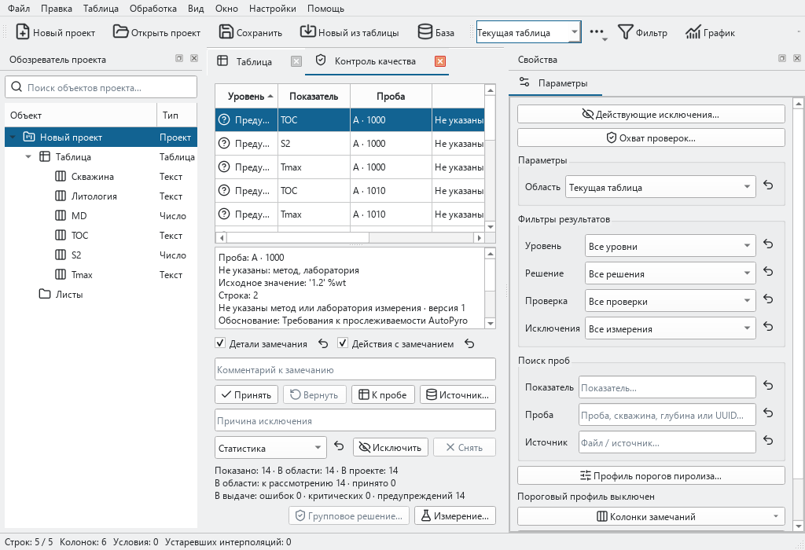

# Аудит AutoPyro перед выпуском · 24 ноября 2026

**Решение. Кандидат 0.1.0 пригоден для сопровождаемого лабораторного пилота. Общий выпуск стоит отложить.** Основной маршрут уже работает целиком. Можно импортировать серию, выбрать рабочий повтор, рассчитать показатель, разобрать замечание QC, восстановить проект и выпустить отчёт. До общего выпуска я бы исправил три воспроизведённых дефекта обмена и истории, однозначно обозначил сборку и получил независимую приёмку на лабораторном материале.

## Изменения после аудита

В рабочем дереве после 0.1.1rc2 предпросмотр и пакетный экспорт используют изолированный источник по выбранным пробам. Для отчётов с включёнными сохранёнными графиками или с архивом совместных подгонок сохраняется полная копия проекта. На шести выбранных пробах из 6000 × 6 подготовка источника заняла 6,3 мс, полная копия на тех же данных — 372 мс (медианы трёх локальных запусков). Отдельными функциями оформлены подготовка контекста измерений, правила совместимости, представление замечаний QC в отчёте, исключение проб из треков, отрисовка маркеров и легенда карты. На контрольном наборе для пяти типов диаграмм растровое изображение, состав проб и причины исключения совпали с реализацией из дистрибутива 0.1.1rc2.

Находки ниже описывают исходное состояние 0.1.0. В **0.1.1rc2** закрыты четыре воспроизводимых дефекта данных. CSV статистики заменяется атомарно, история сравнивает решения QC и комментарии, мастер читает собственные потоковые XLSX и сохраняет ведущие нули для целочисленной маски Excel вида `00000`. Пользователь может свернуть боковые панели через меню «Вид» или Ctrl+Shift+F11. Команда открытия проекта доступна на стартовой странице, предпросмотр файла запускается при открытии мастера. В карточке производной ячейки сводка и протокол доступны отдельно.

Клиент собран из чистой копии тега `v0.1.1rc2` отдельного Git-снимка. Архив исходников включает код клиента, тесты и входы сборки. Для восстановления снимка выполните `git clone AutoPyro-0.1.1rc2-source.bundle autopyro-source` и `git -C autopyro-source checkout v0.1.1rc2`. Для автономной пересборки передайте сборщику папку wheels из распакованного Windows ZIP. [Исходники](../dist/0.1.1rc2/AutoPyro-0.1.1rc2-source.bundle) · [Контрольные суммы](../dist/0.1.1rc2/candidate.json)

Контрольная проверка установленного клиента прошла на первом ПК. Совпали файлы приложения, зависимости и содержание отчёта, открылся 12-страничный PDF, проверен DOCX, после двух автосохранений восстановлено S2 = 3,8. В сравнении с эталоном 0.1.0 изменились только поля версии после исключения времени генерации. Второй ПК, физические экраны и независимая лабораторная серия остаются этапами внешней приёмки. [Windows ZIP](../dist/0.1.1rc2/AutoPyro-0.1.1rc2-windows-x64-py312.zip) · [Комплект оператора](../dist/0.1.1rc2/AutoPyro-0.1.1rc2-laboratory-pilot.zip)

В полном прогоне исправлений собрано 3211 тестов. В четырёх группах Qt offscreen прошли 3197, пропущены 14. В дополнительных запусках подтверждены два нативных теста компоновки и все девять пропущенных случаев Seaborn и UltraPlot. Итого прошли **3208 уникальных тестов**. Три сценария с системным буфером обмена остаются непроверенными на этом кандидате. Windows отказала в создании изолированной станции для этих тестов, действующий буфер содержал пользовательские данные. При масштабах Qt 100%, 125% и 150% команда скрытия панелей увеличила ширину таблицы с 321 до 993 логических пикселей и восстановила исходный размер. [Протоколы полного прогона](../tmp/rc2-complete) · [Целевой набор из 321 теста](../tmp/rc2-focused.xml) · [Приёмка установленного клиента](../tmp/rc2-native-verification/result.json)

## Что проверено

- Объект аудита — текущее рабочее дерево и Windows x64 RC от 24 ноября поверх Git `3f7e7eb`. Проверены SHA-256 обоих имеющихся клиентских ZIP, 464 записи манифеста сборки и содержимое 437 файлов приложения в wheel. Все 464 и все 437 совпали с рабочим деревом. Из 927 записей манифеста полного регресса сейчас отличаются два документа приёмки. Входившие в него файлы приложения и тесты совпали. [Паспорт кандидата](WINDOWS_RELEASE_CANDIDATE_2026-11-24.md)
- Заново прошли **425 штатных тестов**. В 423 проверках Qt использовал offscreen. Они охватили восемь файлов сквозной приёмки и целевые проверки измерений, зависимостей, интерполяции, подгонки, исходных сигналов, интерпретации, сохранения и экспорта. Два теста компоновки отдельно прошли с нативным Qt Windows в светлой и тёмной темах. В уже установленном клиенте из ZIP дополнительно открыты 11 аналитических листов и диалог отчёта. [Сквозной маршрут](../tests/test_pyro_acceptance.py) · [Нативные проверки окон](../tests/test_application_startup.py)
- Полный регресс **3206 уникальных тестов** относится к уже сохранённому прогону кандидата. Основная серия дала 3192 успешных и 14 пропусков, все пропуски закрыты дополнительными запусками. На зависимостях непосредственно из ZIP тогда отдельно прошли 78 тестов статистики и отчётности. Эти результаты и 425 проверок выше частично пересекаются. [Протокол кандидата](WINDOWS_RELEASE_CANDIDATE_2026-11-24.md)
- Дополнительно проверены собственный экспорт XLSX и его чтение мастером, Excel-идентификатор с числовой маской, ошибка записи CSV, смена решения QC между двумя отчётами, размеры рабочей области и стоимость подготовки короткого отчёта. Использовались синтетические данные и контрольный проект. Живой PostgreSQL в этом аудите не подключался. Текущий сквозной тест обновления использует SQLite. Проверки PostgreSQL и длительные нагрузочные замеры взяты из протоколов. Работа независимого геохимика и вторая физическая Windows остаются открытыми. [Приёмка обновления БД](../tests/test_database_refresh_acceptance.py) · [Программа лабораторной проверки](LABORATORY_ACCEPTANCE_2026-11-24.md)

## Дефекты, влияющие на решение о выпуске

| Приоритет | Сценарий и наблюдение | Исправление и условие приёмки |
|---|---|---|
| Высокий · сохранность выгрузки | **Ошибка экспорта статистики уничтожает предыдущий CSV.** В команде экспорта текущей вкладки файл открывается на запись до формирования первой порции CSV. В контрольной проверке исходный корректный файл размером 430 байт после имитации ошибки записи остался размером 0 байт. Проект при этом сохраняется, теряется именно прежняя выгрузка. | Использовать уже имеющуюся атомарную запись. При ошибке в первой и последующей порции прежние байты должны совпадать, при первой записи новый файл должен появляться только после успеха. [Вызов из окна](../autopyro/ui/dialogs/statistics_export.py#L38) · [Запись CSV](../autopyro/data_io/io.py#L259) · [Готовый механизм](../autopyro/data_io/file_output.py) |
| Высокий · история QC | **Два отчёта с разными решениями выглядят одинаковыми в сравнении истории.** На контрольном проекте собраны два отчёта по тем же шести пробам. У одного замечания принятое решение с комментарием переведено в открытое. В JSON действительно изменились решение и комментарий. Все восемь списков различий оказались пустыми. Результат подтверждён и на установленном wheel. Сравнение учитывает исключения измерений, но пропускает решения по замечаниям. | Сопоставить замечания по идентификатору, показать пробу, правило, состояние и изменение комментария. Проверить отдельно принятие, возврат, правку одного комментария и ранее сохранённые снимки. При неполной сопоставимости дать явное объяснение. [Сравнение снимков](../autopyro/reports/history.py#L53) · [Содержимое отчёта](../autopyro/reports/reporting.py#L501) |
| Высокий · обмен данными | **Собственный XLSX нельзя открыть как новую таблицу.** Штатный экспорт двух проб создал книгу с листами Samples, Columns, Sources и Measurements. У потоковых листов границы строк и колонок не записаны. Импорт сравнивает номер заголовка с пустой границей. В установленном клиенте мастер показал Python-ошибку про сравнение `int` и `NoneType`, кнопка «Импортировать» осталась недоступна. | Получать границы листа из фактических данных при отсутствии метаданных. Проверять путь «экспорт выделения → открыть Samples → сверить значения и номера строк». Повторить для пустого листа, явного диапазона и обычной книги Excel. Полное восстановление научного проекта из этой книги не требуется для исправления. [Чтение книги](../autopyro/data_io/io.py#L67) · [Потоковый экспорт](../autopyro/data_io/io.py#L465) |
| Высокий для лабораторий с форматированными ключами | **Два разных видимых обозначения пробы теряют различие при чтении Excel.** В созданной книге числовая ячейка 7 с форматом `00000` выглядит как `00007`, соседняя запись содержит текст `7`. Предпросмотр получил две строки `7`. Выбор текстового типа сделан уже после чтения и нулей не вернёт. Это создаёт неоднозначность при сопоставлении повторов. Буквальный текст `00007` покрыт отдельным работающим случаем. | Для колонок-ключей показывать сохранённое значение и значимую маску Excel, предложить явное правило чтения или предупреждать о совпадении. Сверить оба идентификатора от предпросмотра до добавления повтора. До исправления в пилоте запрашивать такие ключи в текстовом виде. [Чтение ячеек](../autopyro/data_io/io.py#L39) · [Проверки XLSX](../tests/test_pandas_io.py) |
| Высокий · поставка | **Под именем 0.1.0 лежат два разных клиента.** ZIP в корне dist имеет SHA-256 с началом `efd2e2dd`, в каталоге RC — `3c86ef1b`. Верхняя часть инструкции пилота называет прежний хеш кандидатом, хотя там же дана ссылка на новый комплект. Сборщик берёт файлы из рабочей папки. 369 из 464 входных файлов нынешнего манифеста отсутствуют в индексе Git. Содержимое действующего ZIP проверяемо, но одного указанного коммита недостаточно для его восстановления. | Присвоить каждой поставляемой сборке уникальный идентификатор, закрепить полный состав в системе версий, публиковать один паспорт с хешем. Из чистого checkout собрать соответствующий клиент, проверить хеши файлов приложения, версии зависимостей и идентификатор в отчёте. Показать тот же идентификатор в окне «О программе». [Сборщик](../tools/build_windows_release.py#L51) · [Инструкция пилота](RELEASE_PILOT.md) · [Актуальный паспорт](WINDOWS_RELEASE_CANDIDATE_2026-11-24.md) |

## Функциональность и зрелость по областям

| Область | Что может сделать пользователь | Оценка и существенная граница |
|---|---|---|
| Проект и измерения | Сохранить локальный проект, исходные значения, происхождение, анализы, рабочий повтор и историю. Вернуться к прежней редакции пользовательской операции, мигрировать старый файл, восстановить автокопию. | Одна из наиболее зрелых частей. Чтение сверяет хеш до и после операции, запись проверяет конфликт с другим процессом. Для повреждённого оригинала есть восстановление с новым именем. Отдельно следует принять длительность операций на самом большом рабочем проекте лаборатории. [Модель](../autopyro/model/core.py#L198) · [Хранение](../autopyro/database/storage.py#L242) · [Приёмка восстановления](../tests/test_recovery_acceptance.py) |
| Импорт, таблица и выборки | Открыть CSV/TSV/XLSX, настроить лист, диапазон, типы, единицы и шаблоны. Добавить измерения по составному ключу, разобрать конфликты, отфильтровать таблицу, сохранить набор проб, экспортировать выделение с происхождением. | Сильная сторона — отделение нового проекта от добавления анализов и повторная проверка хеша источника перед импортом. Два дефекта XLSX описаны выше. В колонке с числами и ND мастер может предложить текстовый тип. Для новичка выбор типа здесь меняет пригодность данных для последующих расчётов. [Мастер импорта](../autopyro/ui/data_io/import_file.py) · [Область анализа](../autopyro/ui/analysis_scope.py) · [Приёмка таблицы](../tests/test_table_acceptance.py) |
| Источники и БД | Импортировать снимок SQLite или PostgreSQL, получить специализированную геохимию, обновить источник с разбором конфликтов и сохранением локальных решений. В репозитории отдельно живут миграции и инструменты администрирования. | Продуман режим чтения и воспроизводимый локальный снимок. У общего читателя есть предел по умолчанию в 100 000 строк и явная ошибка при превышении. Обновление нескольких независимых БД в одном проекте остаётся расширением. На пилоте нужен отдельный проход с реальной ролью чтения, обновлением исходных записей и временной недоступностью сервера. [Читатели](../autopyro/database/readers.py) · [Подключение](../autopyro/database/connection.py) · [Ограничения](../README.md#ограничения-текущей-версии) |
| QC и расчёт пиролиза | Проверить единицы, физические пределы, совместимость и повторы. Принять замечание, добавить комментарий, исключить измерение из конкретной операции. Рассчитать HI, OI, PI, GP и другие производные с указанием входов и единиц. | Прослеживаемость входит в рабочий процесс. Выбор повтора меняет используемое измерение и результат. Квалификаторы ND и ниже предела можно сохранить отдельно от числа. Особого внимания требуют выбор рабочего измерения и различие между принятием замечания и исключением данных. Экспертные допуски лаборатории следует закрепить для заявленных методов. [Правила QC](../autopyro/analysis/qc.py) · [Формулы](../autopyro/analysis/calculations.py) · [Сквозная проверка](../tests/test_pyro_acceptance.py) |
| Статистика и интерполяция по глубине | Получить описательные показатели, доступность данных, выбросы, корреляции и число пар, открыть входящие пробы. Интерполировать по группам с ограничением разрыва, разбором дубликатов и опор, сохранить результат и его протокол. | Расчёт учитывает пригодность наблюдений. По результату можно найти строки-источники. Устаревшую интерполяцию приходится обновлять явно. Помимо проблемы сохранности CSV, в проверке расчёта на английском языке экспортированная таблица получила русские заголовки. [Статистика](../autopyro/analysis/statistics.py) · [Экспорт вкладки](../autopyro/ui/dialogs/statistics_export.py) · [Ограничения интерполяции](../tests/test_interpolation_constraints.py) |
| Графики, подгонка и исходные сигналы | Готовить графики и многотрековые профили, менять оформление, экспортировать изображения. Подбирать и сравнивать модели, работать с весами, повторной выборкой bootstrap и совместной подгонкой серий. Просматривать пирограммы, сопоставлять каналы, стадии, время и температуру. | Есть архивы результатов, связь с выборкой, проверка устаревания и защита от частично записанных графических файлов. Для подгонки следует независимо проверить выбор модели на сериях лаборатории. Для пирограмм полезнее сначала подтвердить чтение реальных вариантов прибора, затем вводить расчёт площадей пиков. [Подгонка](CURVE_FITTING.md) · [Исходные сигналы](../tests/test_pyrogram_table.py) · [Экспорт графиков](../tests/test_plot_export_safety.py) |
| Геометрическая интерпретация | Привязывать оси и единицы, применять и редактировать схемы, разбирать граничные и неоднозначные результаты, воспроизводить сохранённое решение. | В пакете зафиксированы 39 редакций схем и 323 контрольных случая. Есть тесты, которые намеренно сдвигают границу и замечают смену вывода. Статус независимой научной приёмки нужно показывать по каждой поставляемой редакции. В имеющемся протоколе экспертное решение ожидается для всех 39. [Проверки геометрии](../tests/test_interpretation_reference_cases.py) · [Экспертный протокол](INTERPRETATION_EXPERT_REVIEW.md) · [Состояние приёмки](RELEASE_PILOT.md) |
| Стратиграфия, карты, пространственный и региональный анализ | Привязывать пробы к интервалам, сравнивать редакции, строить межскважинные представления. Загружать векторные слои, задавать систему координат, связывать скважины с пробами, сравнивать области и строить поверхности. | Работа доведена до сохранения, повторного открытия и экспорта. Читатель отклоняет неизвестную CRS и слишком большой слой. В проекте сохраняются объекты и атрибуты импортированного слоя. Для повторной проверки источника на другом ПК всё равно нужны исходные файлы, включая компоненты Shapefile. Пространственные прогнозы требуют проверки на отложенных скважинах в заявленном районе. [Чтение слоя](../autopyro/spatial/mapping.py#L302) · [Сценарий карты](../tests/test_map_workflow_acceptance.py) · [Региональная проверка](../tests/test_regional_geochemistry_acceptance.py) |
| Непиролитическая геохимия и модели | Анализировать изотопы, витринит, газ, фракции и биомаркеры, сравнивать пробы, оценивать смешение. Есть PCA, кластеризация, сохранение моделей и применение к данным другого проекта. | Реализованы содержательные методы и проверки на опубликованных примерах, включая случаи недостаточности данных. Доверие к модели должно быть привязано к веществу, типу измерения, обучающей серии и независимой проверочной серии. Для отдельных профилей ещё важна понятная область действия исключений QC. [Сквозные примеры](../tests/test_geochemistry_workflow_acceptance.py) · [Методы](../SCIENTIFIC_METHODS.md) |
| Отчёты и обмен результатами | Собирать HTML/PDF/DOCX/JSON, выбирать разделы, использовать шаблоны и проверки готовности, выпускать пакет по группам, сохранять и сравнивать снимки. | Вывод работает с зафиксированным набором данных. В текущей версии краткий отчёт уже сворачивает пары без коэффициентов и переводит причины. JSON включает все колонки и исходные ячейки выбранных проб, поэтому его назначение важно объяснять получателю. Самый существенный пробел здесь — сравнение решений QC. [Сборка отчёта](../autopyro/reports/reporting.py#L266) · [Корреляции](../autopyro/reports/correlations.py) · [Пакетный выпуск](../autopyro/ui/dialogs/report_batch.py) |

## Код и сопровождение

**Архитектура позволяет развивать продукт по частям.** Модель проекта, измерения, чтение источников, аналитические ядра, визуализация, отчёты и Qt разнесены по пакетам. У измерения и пробы есть собственная идентичность. Можно проверить расчёт и сравнение снимков без запуска окна. Отдельные объекты отвечают за сеанс проекта, область анализа и жизненный цикл аналитического листа. Совместимость старых импортов проверяется тестами. Эти границы стоит сохранить. [Модель измерений](../autopyro/model/measurements.py) · [Сеанс](../autopyro/ui/project_session.py) · [Документы](../autopyro/ui/analysis_documents.py) · [Архитектурные тесты](../tests/test_ui_architecture.py)

**Сложность сконцентрирована в нескольких функциях.** Разбор AST всех 374 Python-модулей пакета дал 84 210 физических строк и 65 функций длиннее 100 строк. Числа включают комментарии и пустые строки. Для разработчика существеннее то, сколько независимых правил приходится удерживать при локальном изменении.

| Участок | Строк в функции | Где провести границу при следующем изменении |
|---|---:|---|
| [render_plot](../autopyro/visualization/plotting.py#L740) | 581 | Отделить подготовку данных и политику исключений от отрисовки конкретного типа графика. Сравнить точки, подписи и протокол исключений на тех же входах. |
| [_section_blocks](../autopyro/reports/reporting.py#L851) | 559 | Выделять по одному разделу отчёта. Сохранить единый порядок блоков для HTML, PDF и Word. Сверять содержание RU и EN. |
| [run_checks](../autopyro/analysis/qc.py#L324) | 439 | Отделить сбор контекста измерений от отдельных семейств правил. Зафиксировать идентификаторы замечаний, от которых зависят сохранённые решения. |
| [render_map](../autopyro/spatial/mapping.py#L949) | 360 | Разделить расчёт геометрии представления, оформление слоёв и легенду. Сверять координаты и число отображённых объектов. |
| [build_report](../autopyro/reports/reporting.py#L266) | 336 | Сделать явными границы выборки, замораживания источника и формирования разделов. Сохранить работу старых снимков. |

**Основной риск сопровождения — негласные контракты между модулями.** Решения и исключения QC находятся в разных структурах. Автор сравнения отчётов учёл одну, хотя обе влияют на вывод. В UI формы передают объект листа множеству функций, которые читают его поля напрямую. Наличие атрибутов и момент их инициализации приходится искать по нескольким файлам. Для часто изменяемых контрактов уместны именованные типы и тесты границ. Начать стоит с решения QC, состава снимка и параметров подгонки. Массовая замена всех словарей перед релизом увеличит риск несовместимости. [Сравнение](../autopyro/reports/history.py#L53) · [Оркестрация подгонки](../autopyro/ui/dialogs/curve_fitting_calculation.py#L59)

**Тестовую стратегию стоит дополнить парными операциями.** В проекте 147 файлов `test_*.py`. Тесты уже проверяют миграции, отказ записи графиков, undo/redo, границы геометрии и сохранение выбранного повтора. Обнаруженные проблемы находятся между такими проверками. Прямой тест «создать XLSX» проходит, но связка «создать → прочитать» ломается. Нужны несколько одинаковых проверок сохранности по всем публичным командам экспорта и сравнение двух отчётов после одного осмысленного изменения. Слой совместимости старых импортов полезен для существующих вызывающих программ. В новых тестах предпочтительны канонические пути, старые можно оставить специализированному набору. [Совместимость](../autopyro/_compat.py) · [Проверки импорта Excel](../tests/test_pandas_io.py)

## Интерфейс и удобство

**Опытный пользователь получает понятный рабочий стол.** Дерево показывает объекты проекта, вкладки удерживают контекст, общая область анализа связывает фильтр, выделение и именованный набор с разными инструментами. В QC видны проба, исходное значение и объяснение замечания. Переходы к пробе и источнику экономят повторный поиск. В отчёте изменение настроек помечает старый предпросмотр и требует собрать новый снимок. Оба оформления выдержали штатные нативные проверки компоновки. [Выборка](../autopyro/ui/analysis_scope.py) · [Состояние предпросмотра](../autopyro/ui/dialogs/report_preview.py#L79)

**На ноутбуке боковые панели занимают место, нужное для самого решения.** На свежей компоновке 1024 × 700 область данных таблицы демопроекта составила 321 × 533 пикселя. В QC рабочий лист получил ширину 376 пикселей. На снимке ниже обрезаны уровень замечания, текст в списке и подпись кнопки «Источник…». Подробность выбранной записи доступна внизу. Проблема проявляется, когда нужно быстро просмотреть и сравнить несколько замечаний подряд. Дать компактный режим, который сворачивает дерево или свойства одной командой и запоминает выбор. Проверить доступность пробы, причины, решения и действия с клавиатуры при 100%, 125% и 150% на физических экранах. [Раскладка панелей](../autopyro/ui/workspace.py#L226)

Снимок получен с Qt offscreen в этом аудите. Измерения относятся к указанному окну, теме и шрифту.

**Первый запуск хорошо показывает источники, слабее объясняет повседневный маршрут.** На стартовой странице четыре кнопки, из них две относятся к БД. Сохранённый проект открывается из меню или панели инструментов. В меню «Файл» 18 команд верхнего уровня, в «Таблица» — 13, а в «Помощь» только «Что это?». Встроенное демо содержит 5 строк и 6 колонок, пример из руководства — 6 строк и 9 колонок. Пользователь демо не найдёт Formation и Method, необходимые для пошагового примера в README. Предлагаю вынести «Открыть проект» на стартовую страницу, оставить один вход в источники БД и связать демо с конкретным упражнением и ожидаемым результатом. [Стартовая страница](../autopyro/ui/workspace.py#L182) · [Меню](../autopyro/ui/window_actions.py) · [Демо](../autopyro/ui/project_session.py#L149) · [Первый сценарий](../README.md#первый-сценарий)

**Предпросмотр импорта должен объяснять последствия выбора типа.** Сейчас пользователь открывает файл, затем отдельно нажимает «Прочитать / обновить предпросмотр». После изменения настройки импорт блокируется, а прежняя таблица может оставаться видимой. Имеет смысл запускать первое чтение автоматически и помечать видимый предпросмотр как устаревший при последующем изменении настроек. Для смешанной колонки полезна подсказка с фактическими количествами чисел, ND и пороговых записей и результатом выбора числового типа. Подтверждение сопоставления проб остаётся отдельным осмысленным действием. [Мастер](../autopyro/ui/data_io/import_file.py#L177)

**Получателю результата нужен краткий ответ, аналитическая подробность — по запросу.** В карточке производного значения уже есть переходы к опорным пробам, но параметры расчёта, диагностика и источник могут выводиться вложенным JSON. В основном виде вывести название показателя, значение с единицей, использованные пробы, формулу, актуальность и причину исключения. Полный протокол сохранить доступным для сверки. Для поддержки добавить в справку версию сборки и короткий маршрут восстановления. Проверить с геохимиком, может ли он объяснить выбранный повтор и область QC без помощи разработчика. [Карточка производной ячейки](../autopyro/ui/dialogs/measurement.py#L44) · [Справка](../autopyro/ui/window_actions.py#L127)

## Производительность и эксплуатация

| Условие | Что известно | Что это значит для выпуска |
|---|---|---|
| 30 000 × 12, 10 треков, 15 000 выбранных проб | По записанному нативному прогону установленного RC после окончания параллельного регресса первый кадр готов через 4,04 с от команды. Максимальная пауза при автосохранении — 73,9 мс, публикация копии — 18,11 с. | Отзывчивость и свежесть копии измеряют разные свойства. Для пилота согласовать оба показателя и проверить последнюю сохранённую правку. [Замеры RC](WINDOWS_RELEASE_CANDIDATE_2026-11-24.md) |
| 10 000 × 80, широкая таблица | По предыдущему замеру повторное открытие заняло около 22,5 с, сохранение восстановленного проекта — около 41 с, максимальная пауза при открытии — около секунды. | Озвучивать рабочий диапазон вместе с условиями стенда. Проверить ожидание и индикацию прогресса на типичном и крупнейшем проекте пользователя. [Предыдущий протокол](RELEASE_REVIEW_2026-11-23.md) |
| Отчёт по 6 строкам из большого проекта | Свежий микрозамер двух стадий штатной сборки. На проектах 600 и 6000 строк × 6 колонок медиана трёх копирований всего проекта составила 0,035 и 0,429 с. Последующая сборка разделов QC и статистики по тем же шести строкам заняла 0,027 и 0,029 с. Время интерфейса и экспорта здесь не измерялось. | При жалобе на короткий отчёт первым делом профилировать полную копию. Оптимизация должна сохранять возможность пакетного выпуска, воспроизведение зависимых расчётов и согласованность снимка. [Подготовка исходника отчёта](../autopyro/ui/dialogs/report_preview.py#L94) |

Офлайн-комплект содержит клиент и 38 зависимостей с хешами. Для установки нужен уже установленный CPython 3.12 x64, создание окружения и запуск команд PowerShell. Это приемлемо для пилота с инженером сопровождения. Для самостоятельного развёртывания лаборантом приоритетнее один проверяемый установочный сценарий и понятная диагностика запуска. Стоимость перехода на иной упаковщик стоит оценивать после второй установки. [Инструкция](WINDOWS_INSTALL.md)

## Что добавить после стабилизации

| Очерёдность | Возможность | Практическая ценность |
|---|---|---|
| 1 | Переносимый комплект проекта с описью и хешами выбранных исходников, внешних снимков отчётов и компонентов пространственных слоёв | Позволит другому специалисту найти оригинал, проверить его идентичность и повторить работу на второй машине. |
| 2 | Общий список сохранённых результатов с выборкой, редакцией метода, причиной устаревания и переходом к исходным пробам | Упростит повторный выпуск серии после изменения рабочего измерения или схемы. Основу уже дают локальные архивы модулей. |
| 3 | Сохраняемый сценарий обработки серии и его командный запуск | На подтверждённых шаблонах сможет повторять импорт, QC, расчёт и пакетный выпуск. Пакетные отчёты по группам уже есть. Полезное дополнение — воспроизведение всей последовательности с остановкой на неоднозначном сопоставлении. |
| 4 | Отраслевые расширения по спросу пилота | Интегрирование пиков для подтверждённых приборов, траектории скважин и пересчёт MD в TVD/TVDSS, импорт LAS. Каждое направление требует согласованных входов и независимых примеров. |

## План до релиза

| Этап | Кто ведёт | Действия | Измеримый результат для перехода дальше |
|---|---|---|---|
| 1. Зафиксировать объект испытаний | Ответственный за выпуск | Закрепить состав исходников, дать исправляемому RC уникальный идентификатор, убрать двойное указание текущего ZIP из инструкций. | Сборка из чистого checkout соответствует манифесту, оператор по инструкции выбирает нужный ZIP, отчёт и приложение показывают один идентификатор. |
| 2. Закрыть дефекты данных | Разработчики импорта, отчётов и статистики | Исправить запись статистического CSV, сравнение решений QC и чтение собственного XLSX. Согласовать политику форматированных ключей. Добавить регрессии на каждый воспроизведённый случай. | Старая выгрузка побайтно цела после ошибки. Изменение решения и комментария видно в сравнении. Экспорт двух проб читается обратно. Ключи `00007` и `7` различимы либо требуют явного решения до применения. |
| 3. Принять повседневный интерфейс | Разработчик UI и геохимик | Проверить компактную раскладку, импорт с квалификаторами, демо, отчёт и справку. Привести язык CSV в соответствие с выбранным языком. | На рабочем экране геохимик самостоятельно открывает серию, находит повтор, объясняет решение QC, формирует отчёт и находит восстановление. Зафиксированы затруднения и фактически применённая выборка. |
| 4. Проверить исправленный комплект | QA и ответственный за выпуск | Повторить полный регресс, нативные и опциональные проверки. Установить ZIP без сети на второй чистой Windows. Проверить открытие и миграцию старого проекта, автокопию во время правок, восстановление и выпуск отчёта. | Протокол привязан к хешу исправленного ZIP. Исходники серии и оригинал проекта сохранны. Рабочие измерения, решения и содержимое согласованных отчётов совпадают между ПК. PDF и DOCX открыты и просмотрены. [Готовая процедура](LABORATORY_ACCEPTANCE_2026-11-24.md) |
| 5. Определить область общего выпуска | Геохимик и владелец продукта | Принять независимую серию с повторами, ND и численным пределом обнаружения. До расчёта записать ожидаемые результаты и допуски. Проверить рабочие объёмы, отдельно назвать принятые методики и версии схем. | Подписана карточка серии, определены рабочий размер и допустимое ожидание, для каждого заявленного метода известны область применения и ограничения. Методы в экспертной проверке явно помечены в интерфейсе и отчётах. [Карточка серии](LABORATORY_SERIES_RECORD.md) |

**Критерий выпуска** — один идентифицируемый комплект проходит техническую и лабораторную приёмку, а второй специалист может получить тот же научный результат и увидеть, что изменилось между редакциями. Большой рефакторинг визуализации и расширение каталога методов можно вести после выпуска в согласованной области применения.
